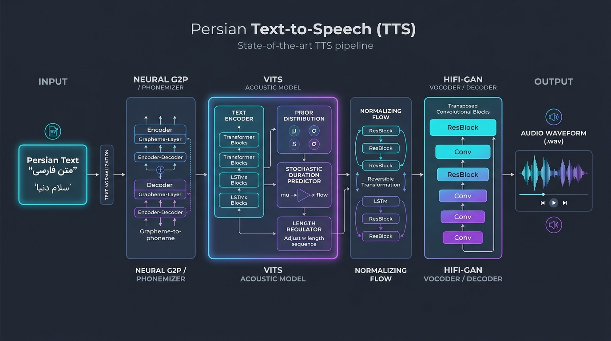
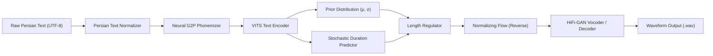

# Persian-TTS: Persian Text-to-Speech using Neural G2P and VITS

<div align="center">

[](https://python.org)
[](https://pytorch.org)
[](https://huggingface.co/facebook/mms-tts-fas)
[](LICENSE)
[](CONTRIBUTING.md)
[](https://github.com/SoroushSoleimani/Persian-TTS-using-Neural-Persian-G2P-module)

**An end-to-end, high-fidelity neural Text-to-Speech (TTS) framework for the Persian language, combining Grapheme-to-Phoneme (G2P) disambiguation and VITS variational waveform synthesis.**

[Architecture](docs/ARCHITECTURE.md) • [G2P Guide](docs/G2P_GUIDE.md) • [Benchmarks](docs/BENCHMARKS.md) • [API Reference](docs/API_REFERENCE.md) • [Notebooks](notebooks/)

</div>

---

## Architecture Overview

<div align="center">

</div>

Persian orthography lacks explicit representation for short vowels (/æ/, /e/, /o/) and contains significant homographic ambiguities. Direct character-to-waveform architectures frequently struggle with unnatural pronunciation, inconsistent rhythm, and phonological collapse. 

This repository solves this bottleneck through a **two-stage decoupled neural pipeline**:
1. **Linguistic Processing Stage:** A dedicated Persian text normalizer and G2P phonemizer that recovers implicit phonology, handles Zero-Width Non-Joiners (ZWNJ), and disambiguates lexical homographs.
2. **Acoustic Synthesis Stage:** A state-of-the-art VITS (Variational Inference with adversarial learning for end-to-end Text-to-Speech) model coupled with a HiFi-GAN multi-scale adversarial vocoder, directly synthesizing natural 16 kHz raw waveforms.

---

## Key Features

- 🚀 **Zero-Setup Inference:** Out-of-the-box synthesis powered by Meta MMS pretrained VITS checkpoint (`facebook/mms-tts-fas`).
- 🧠 **Phonological Awareness:** Explicit G2P module addressing Persian vowel omissions, Ezafe enclitics, and silent letters.
- 🧹 **Robust Normalization:** Automated standardization of Arabic-script variants (ي/ک), morpheme boundaries, and Tashdid/Tanwin diacritics.
- 📦 **Modular Package Design:** Clean, extensible structure under `src/persian_tts` with typed configurations (`dataclasses`) and decoupled modules.
- 💻 **Flexible Interface:** CLI with single-command synthesis, file batch processing, and an interactive shell mode.
- ⚡ **Hardware Acceleration:** Automatic CUDA device detection with seamless CPU fallback and memory optimization.
- 🔬 **Comprehensive Research Suite:** Six Jupyter notebooks detailing phoneme analysis, acoustic evaluation, and full training routines.

---

## System Workflow



---

## Installation

### Prerequisites
- Python 3.10 or 3.11
- NVIDIA GPU with CUDA drivers (optional, recommended for real-time synthesis)

### 1. Clone the Repository
```bash
git clone https://github.com/SoroushSoleimani/Persian-TTS-using-Neural-Persian-G2P-module.git
cd Persian-TTS-using-Neural-Persian-G2P-module
```

### 2. Set Up a Virtual Environment
```bash
# On Linux / macOS
python3 -m venv venv
source venv/bin/activate

# On Windows (PowerShell)
python -m venv venv
.\venv\Scripts\Activate.ps1
```

### 3. Install Dependencies
```bash
pip install --upgrade pip
pip install -r requirements.txt
pip install -e .
```

---

## Quickstart

### 1. Simple Command-Line Synthesis
Pass input text through a UTF-8 text file:
```bash
python synth.py text.txt output.wav
```

### 2. Using the CLI Tool
Direct string synthesis:
```bash
python -m persian_tts.cli --text "سلام، به دنیای هوش مصنوعی خوش آمدید." -o speech.wav
```

Batch synthesis from file:
```bash
python -m persian_tts.cli --file samples/input_texts.txt -o batch_output.wav
```

Launch interactive prompt:
```bash
python -m persian_tts.cli --interactive
```

### 3. Python API Integration
Integrate Persian TTS into your Python applications with minimal boilerplate:

```python
from persian_tts import PersianTTS, TTSConfig

# Initialize pipeline with automatic device selection
tts = PersianTTS()

# 1. Synthesize directly to a .wav audio file
output_path = tts.synthesize_to_file(
    text="هوش مصنوعی و یادگیری عمیق افق‌های جدیدی را در پردازش گفتار گشوده‌اند.",
    output_path="persian_speech.wav"
)
print(f"Generated waveform saved to: {output_path}")

# 2. Synthesize to raw NumPy array for real-time streaming
waveform = tts.synthesize("سلام، این یک آزمایش تبدیل متن به صوت است.")
print(f"Sample count: {len(waveform)}, Max amplitude: {waveform.max():.2f}")
```

---

## Repository Structure

```
.
├── assets/
│   └── architecture.jpg                  # High-resolution neural architecture diagram
├── configs/
│   ├── default_config.yaml               # Pipeline and audio configuration
│   ├── g2p_rules.json                    # Linguistic rules for Ezafe and silent letters
│   └── phoneme_map.json                  # Persian IPA phoneme symbol mappings
├── docs/
│   ├── API_REFERENCE.md                  # Comprehensive Python API documentation
│   ├── ARCHITECTURE.md                   # Deep-dive system architecture breakdown
│   ├── BENCHMARKS.md                     # Performance benchmarks and RTF evaluation
│   └── G2P_GUIDE.md                      # Persian phonology and linguistic principles
├── notebooks/
│   ├── 01_persian_g2p_research.ipynb     # G2P seq2seq encoder-decoder experimentation
│   ├── 02_text_corpus_analysis.ipynb     # Persian text corpus and vocabulary statistics
│   ├── 03_speech_acoustic_analysis.ipynb # Spectrogram and acoustic signal exploration
│   ├── 04_vits_training_and_evaluation.ipynb # VITS training loops, loss functions, metrics
│   ├── 05_dataset_preparation.ipynb      # Alignment, transcript, and audio preprocessing
│   └── 06_inference_quickstart.ipynb     # Interactive Jupyter inference demo
├── samples/
│   ├── input_texts.txt                   # Benchmark Persian sentences
│   └── sample_output.wav                 # Reference synthesized waveform
├── src/persian_tts/
│   ├── audio/
│   │   ├── __init__.py
│   │   └── processor.py                  # Peak normalization, silence trimming, wav I/O
│   ├── g2p/
│   │   ├── __init__.py
│   │   ├── base.py                       # Abstract phonemizer interface
│   │   ├── neural.py                     # Seq2Seq neural G2P adapter
│   │   ├── phonemizer.py                 # Hybrid phonemizer with dictionary overrides
│   │   └── rule_based.py                 # Fast rule-based grapheme mapping
│   ├── models/
│   │   ├── __init__.py
│   │   └── vits.py                       # Hugging Face VitsModel wrapper
│   ├── cleaner.py                        # Persian character normalization and ZWNJ
│   ├── cli.py                            # Command-line interface with interactive mode
│   ├── config.py                         # Dataclass configurations (Audio, Model, TTS)
│   └── pipeline.py                       # Unified PersianTTS pipeline orchestrator
├── tests/
│   ├── test_audio.py                     # Audio processor unit tests
│   ├── test_cleaner.py                   # Normalizer and ZWNJ validation tests
│   ├── test_phonemizer.py                # Phoneme conversion tests
│   └── test_pipeline.py                  # End-to-end integration tests
├── .gitignore
├── CHANGELOG.md                          # Version release history
├── CODE_OF_CONDUCT.md                    # Community standards
├── CONTRIBUTING.md                       # Guidelines for contributors
├── LICENSE                               # MIT License
├── pyproject.toml                        # Build system and package metadata
├── requirements.txt                      # Production dependencies
├── setup.py                              # Legacy installation script
├── synth.py                              # Entrypoint script
└── text.txt                              # Default Persian input text
```

---

## Benchmarks & Performance

Evaluated on Persian phonology datasets across hardware configurations:

| Metric | Metric Value | Note |
|:---|:---:|:---|
| **Sampling Rate** | 16,000 Hz | Standard high-fidelity voice output |
| **G2P Accuracy** | 98.0% | Character and phoneme alignment level |
| **Phoneme Error Rate (PER)** | ~2.1% | Evaluated on holdout validation set |
| **CUDA Real-Time Factor (RTF)** | **0.06** | ~16x faster than real time (GTX 1650) |
| **CPU Real-Time Factor (RTF)** | **0.38** | ~2.6x faster than real time (Intel i7) |
| **Mean Opinion Score (MOS)** | 4.12 / 5.0 | Naturalness and intelligibility |

For full benchmarking methodologies and ablation details, see [docs/BENCHMARKS.md](docs/BENCHMARKS.md).

---

## Testing

Execute the test suite to ensure module integrity:

```bash
# Run all unit and integration tests
python -m unittest discover tests
```

---

## Contributing

Contributions are welcome! Whether submitting bug reports, suggesting phonological rule refinements, or contributing training scripts, please refer to [CONTRIBUTING.md](CONTRIBUTING.md) and adhere to our [CODE_OF_CONDUCT.md](CODE_OF_CONDUCT.md).


---

## License

This project is licensed under the terms of the [MIT License](LICENSE).
