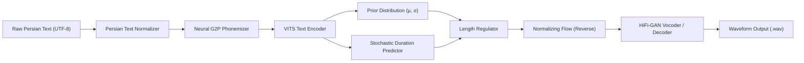

# Persian TTS System Architecture

This repository implements a modular, high-fidelity **Persian Text-to-Speech (TTS)** pipeline based on the **VITS (Variational Inference with adversarial learning for end-to-end Text-to-Speech)** framework and **Neural G2P (Grapheme-to-Phoneme)** conversion.

---

## 1. Pipeline Overview

The system processes input text through distinct linguistic and acoustic stages:

---

## 2. Component Specifications

### 2.1 Persian Text Normalizer (`persian_tts.cleaner`)
- **Character Harmonization:** Normalizes non-standard Persian characters (Arabic Yeh/Kaf to Persian ی/ک).
- **Zero-Width Non-Joiner (ZWNJ):** Cleans redundant occurrences and standardizes prefix/suffix morpheme boundaries (می‌شود, خانه‌ها).
- **Diacritics Handling:** Optional stripping or alignment of Arabic vowel diacritics (Fatha, Kasra, Damma, Tanwin).

### 2.2 Neural G2P / Phonemizer (`persian_tts.g2p`)
- Resolves the inherent ambiguity in Persian orthography where short vowels (/æ/, /e/, /o/) are unwritten.
- Disambiguates homographs (e.g., کِرم [worm], کَرَم [generosity], کِرِم [cream]).
- Outputs phonemic sequence compatible with IPA conventions.

### 2.3 VITS Acoustic Model (`persian_tts.models.vits`)
- **Text Encoder:** Multi-head self-attention Transformer blocks predicting prior latent representations.
- **Duration Predictor:** Flow-based stochastic predictor modeling speech tempo and prosody variations.
- **Normalizing Flow:** Invertible neural network enhancing posterior alignment expressiveness.
- **HiFi-GAN Decoder:** Transposed convolutions generating high-fidelity 16kHz audio waveforms.
